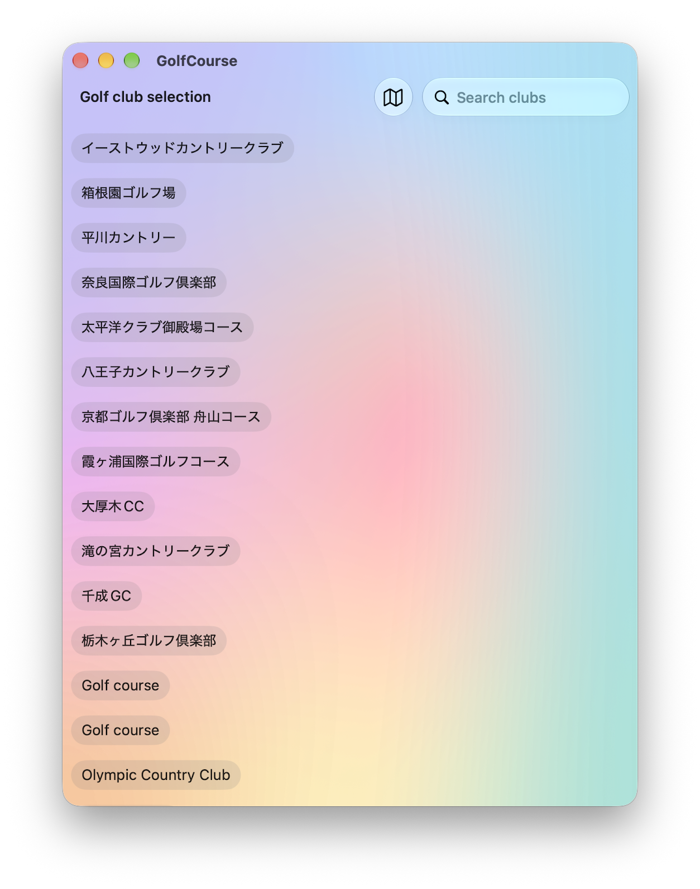
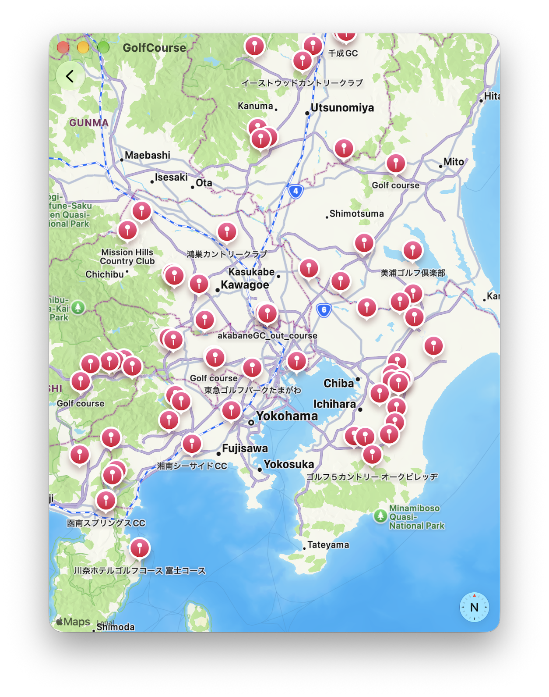
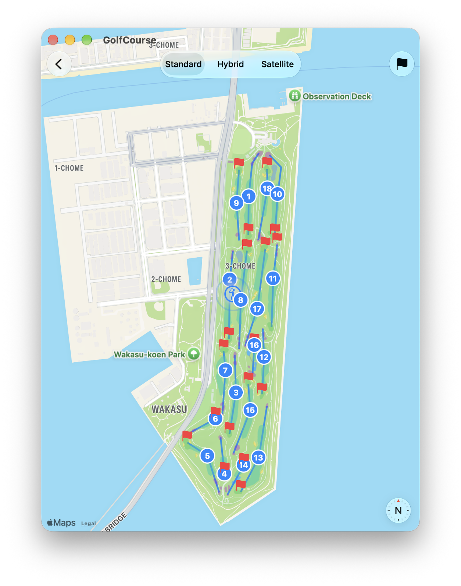
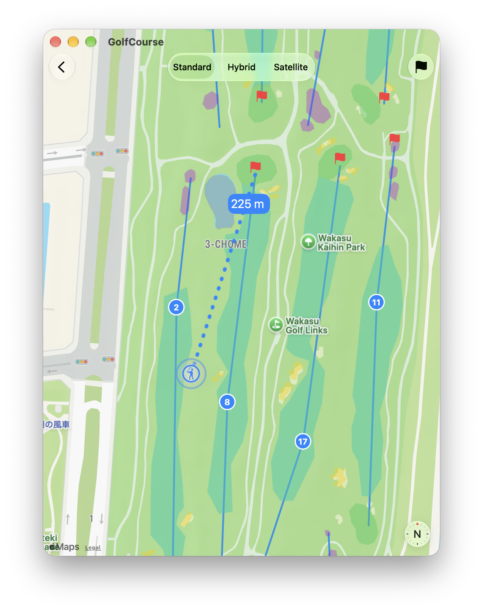

#  OpenStreetMap Golf courses

An experiment with **OSM Overpass** to display golf courses in Japan on a map.

  
   
   
   

### Currently

Using the JSON file (/Resources/japan.json) generated by running the Python preprocessor at: 
"https://github.com/workingDog/osm-golf-courses" as the source of data for all golf courses.

I modified the original python code from "https://github.com/henrikdav/osm-golf-courses", 
to generate the features I’m interested. See "full-feature" branch of my fork. These include:

"green", "tee", "fairway", "bunker", "water_hazard", "lateral_water_hazard", "pin"

Run it with:

python3 build.py --fetch

I’m particularly interested in pin locations, which can be used to display the distance between a golfer and the selected pin.

### Previous experiment

Initially (see OSMContentView) directly using:

EndPoint "https://overpass-api.de/api/interpreter"

## References

Browser based see "https://overpass-turbo.eu/"

Overpass doc see "https://dev.overpass-api.de/overpass-doc/en/index.html"

See also "https://overpass-api.de/"

Should look at using: "https://github.com/V4ulthunt3r/SwiftOverpassAPI"

